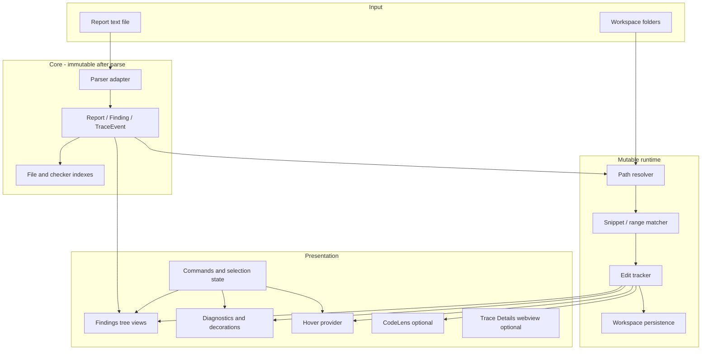

# Design document — Coverity Report Helper

**Status:** Planning (no application code yet)  
**Requirements source:** [CURSOR_COVERITY_EXTENSION_PROMPT.md](./CURSOR_COVERITY_EXTENSION_PROMPT.md)  
**Last updated:** 2026-11-04

## 1. Problem statement

Developers work on embedded C/C++ in VS Code (folder workspace) while Coverity analysis runs elsewhere (e.g. Keil µVision, WSL/Docker). They need to **load an existing text report** and **navigate findings in source**—markers, sidebar, hover, optional CodeLens—without building, debugging, or connecting to Coverity services.

The extension **does not** analyze C/C++, prove fixes, or upload source. It **parses report text** and **tracks locations** as the user edits.

## 2. Goals and non-goals

### Goals

- Parse and display Coverity-style **text reports** with clear parse status and warnings.
- **One canonical finding** per issue; index by file for navigation; full trace always available.
- **Editor integration:** diagnostics (with display policy), decorations, hover, overview ruler, navigation commands.
- **Edit-aware positions** with conservative uncertainty; persist adjusted ranges when fingerprints match.
- **Path resolution** with explicit mappings; never silent wrong-file navigation.
- **Distributable extension folder** (bundled deps, no npm on target machine).
- **Optional:** WSL/Docker rerun hooks; optional run comparison (separate milestones).

### Non-goals

- Keil project conversion, compiler/LSP setup, Coverity license or server integration for viewing.
- Semantic proof that a finding is fixed or that snippet match is the exact AST node.
- Arbitrary HTML inside native Peek Problem; gutter “Git graph” lanes unless public APIs support them.
- Executing anything from report contents; network lookups at runtime.

## 3. Terminology (canonical)

| Term | Definition |
|------|------------|
| **Finding** | One reported issue; ordered **trace events** |
| **Trace event / step** | Location + label + raw payload |
| **Checker ID** | Issue type (e.g. `FORWARD_NULL`); used for Error type grouping when present |
| **Event tag** | Step kind (e.g. `var_deref_op`); **not** a finding ID or error type |
| **Step number** | Trace order (1, 2, 3…); not severity |
| **Original location** | From report; immutable |
| **Current range** | After path resolve + snippet match + edit tracking |

**Integrity rules:** Do not treat last/highest step as main defect unless report says so. Do not infer severity from step count or event tag.

## 4. High-level architecture

### Single source of truth for selection

- **Active finding ID** and **active step index** (report-local, stable for session).
- All surfaces (tree, editor, hover, CodeLens, optional details) subscribe to the same selection model.
- **View-occurrence IDs** for tree nodes when the same finding appears under multiple files/groups.

## 5. Module boundaries (planned)

| Module | Responsibility |
|--------|----------------|
| `parser/*` | Text → immutable model; warnings; raw block retention; **only** place format rules live |
| `model/*` | Types, schema version, IDs, fingerprints, indexes |
| `paths/*` | URI normalization, workspace roots, user mappings, unresolved handling |
| `ranges/*` | Snippet match, UTF-16/line-end policy, uncertainty flags, multiline when verified |
| `tracking/*` | `onDidChangeTextDocument` transforms; debounced refresh |
| `persistence/*` | Cache read/write, invalidation, reset adjusted locations |
| `views/*` | TreeDataProvider projections: Files / Folders / Error type |
| `diagnostics/*` | DiagnosticCollection, severity display policy, related locations for Peek |
| `hover/*` | MarkdownString content, trusted command links |
| `codelens/*` | Optional; collision aggregation |
| `decorations/*` | Overview ruler, optional badges; **no** DOM hacks |
| `rerun/*` | Optional WSL/Docker task launcher + config |
| `compare/*` | Optional snapshot diff between runs |
| `extension.ts` | Activation, disposables, wiring |

Dependencies flow **inward:** UI → tracking/persistence → model; parser has no VS Code UI imports.

## 6. Data model (conceptual)

### Immutable (parse result)

- **Report:** schema version, fingerprint/hash, optional summary text (preserved, not used for nav), parse warnings, list of findings.
- **Finding:** stable report-local ID, optional checker/CID/impact/main-event flags, raw block reference, ordered events.
- **TraceEvent:** index in finding, raw label, raw payload, original path string, original line/column (as parsed), optional metadata fields if present in report.

### Mutable (runtime)

- **ResolvedLocation:** URI or unresolved reason, original position, **current** `Range`, **TrackingStatus** (`confident`, `uncertain`, `stale`, `unresolved`, etc.).
- **LocationCache entry:** event ID, ranges, status, content hash at time of alignment, report hash.

IDs: use Coverity CID when exported; else deterministic local IDs (hash of block + index), with collision handling for duplicate blocks.

## 7. Indexing rules

- Index **events** by normalized workspace URI.
- **Finding** appears once in global count; file views show **at most one row per finding per file** (not one row per event in same file).
- Expanding a finding always shows **full trace** (all files).
- Error type view: group by **checker ID** only; unknown → “Unknown type”.

**Counting UX:** Tooltip explains that per-file sums can exceed global count for cross-file findings.

## 8. Findings sidebar

**View id:** `coverityFindings` (name TBD in `package.json`).

### Layouts

1. **Files (default):** flat file list → findings → steps (skip single-step intermediate node).
2. **Folders:** same leaves; insert folder ancestors only where report paths sit.
3. **Error type:** checker group → files (filtered) → findings → steps.

### Controls (title toolbar / commands)

- Load Report, Reload Report (explicit; refresh layout ≠ reload).
- View by (single selector).
- Active file only.
- Search/filter (command + quick pick or similar).
- Collapse All.
- Severity filter **only if** report provides severity metadata.
- Settings toggles: CodeLens, trace badges, experimental lanes (default off).

### Selection and expansion

- Preserve selection by **finding/step identity** across layout changes.
- Preserve expansion where TreeView API allows.

## 9. Editor navigation and markers

### Click behavior

- **Step:** open URI, reveal range, set active finding/step, reveal tree occurrence.
- **Finding:** navigate to main event if report marks it; else **first event** as fallback only (UI must not label that as “the defect”).

### On file open

- Publish markers/diagnostics for that document without requiring sidebar click first.

### Diagnostics policy

- Source: `Coverity Report` (or constant) to distinguish from compiler/LSP.
- Supporting trace steps: subdued severity / related information—not every step as `Error`.
- Document **display fallback** when impact unknown (not Coverity’s rating).
- Avoid duplicate message text in hovers when diagnostic already shows it.

### Snippet matching

- Prefer report ranges if present.
- Else: match payload on reported/tracked line (trim outer whitespace only); use column to disambiguate.
- Ambiguous → uncertain; no whole-project search.
- Invalid/out-of-range → safe fallback range + visible flag.

**Coordinate policy:** Document assumption until verified (0-based vs 1-based line, tab width, UTF-16). Map to VS Code positions explicitly in one place.

## 10. Hover and trace navigation

Content (when data exists): label, lookup description, payload, checker, step N of M, trace list, Previous/Next.

- **Preferred:** styled timeline if MarkdownString/icons suffice.
- **Fallback:** numbered list, current step bold + “Current”.
- Long traces: neighborhood + “Show full trace” → sidebar/details.

**Security:** Escape user/report text; allowlist command IDs; validate finding/event IDs in command handlers.

Commands: `Previous Trace Step`, `Next Trace Step` (+ optional keybindings); order = **trace order**, not line number; no wrap at endpoints.

## 11. Peek Problem vs custom details

- Feed diagnostics + related locations so **native** Peek can help; verify behavior in Extension Development Host.
- Do **not** promise custom timeline inside Peek.
- Optional **Trace Details** webview (panel/sidebar/tab) for rich timeline; shares components with other webviews if any.

## 12. CodeLens (optional feature)

- Short line: known checker/title + step N of M.
- Click → reveal finding/step; optional prev/next.
- Multiple findings same line → one lens “N Coverity findings” + chooser.
- Setting to disable; throttle refresh.

## 13. Gutter badges and lanes (optional / experimental)

- Badges for **active finding steps only**; show step numbers tied to selection.
- **Lanes/arrows:** prototype against public Decoration API; if unsupported, defer to Trace Details webview.
- Fixed lane width if ever implemented; never widen editor unbounded.

## 14. Edit tracking

- Listen: `workspace.onDidChangeTextDocument` (all relevant docs).
- Transform ranges using change events (multi-edit, undo/redo, insert before/inside/after).
- Overlap → uncertain; deletion → do not reattach to unrelated text.
- Debounce heavy recomputation; **never** full reparse on keystroke.

**Baseline:** Edits before load/activation cannot be reconstructed; show mismatch/stale; optional user-provided analyzed snapshot comparison (future hook).

## 15. Persistence

- Store: adjusted ranges, status, report hash, URI mapping identity, **content hash** of referenced source.
- Invalidate when report or content changes; handle dirty buffers (don’t cache unsaved content against disk hash).
- Commands: **Reset adjusted locations** (does not rewrite report file).
- File renames: use workspace file events + conservative remapping.

## 16. Path resolution

Order:

1. Exact path match (normalized slashes, case per OS).
2. User-configured report-root → workspace-root mappings.
3. Unresolved → tree/diagnostic entry + **Configure path mapping** action.

Never: pick random same basename, scan drive, execute report paths.

External SDK paths (Keil/CMSIS): show as unresolved or mapped—not dropped.

## 17. Descriptions lookup

- Bundled JSON (versioned): keys by checker ID and event tag.
- Brief independent wording + link to docs where redistribution allows.
- Offline; unknown → show raw label only.
- Lookup text is **general guidance**, separate from report payload.

## 18. Build and distribution

- **build:** compile/bundle extension entry.
- **stage:** output `dist-extension/<publisher>.<name>-<version>/` with `package.json`, `main` JS, assets, bundled runtime deps (`vscode` external).
- README: copy-to-extensions-dir, reload, Cursor vs VS Code paths, `--extensions-dir`, remote.

## 19. Optional: Rerun Coverity (WSL/Docker)

See checklist milestone **M-optional-rerun**. Design constraints:

- Workspace Trust required; config is user-supplied executable/script—not from report.
- Task or terminal; concurrency guard; cancel launcher vs container documented honestly.
- On success: verify new report file, atomic replace, reparse, **new** tracking baseline; don’t carry old adjusted ranges blindly.
- On failure: keep previous report.

## 20. Optional: Compare runs

See checklist milestone **M-optional-compare**. Snapshot previous successful report; categories New / Still / No longer / Uncertain; stable Coverity IDs when available; conservative heuristics otherwise; “No longer reported” ≠ “Fixed” without comparable scan.

## 21. Performance

- Target ~20k findings (unconfirmed): lazy tree nodes, avoid reading all files on activate.
- Parse once per load/reload; index in memory.

## 22. Testing strategy

- **Unit:** parser fixtures, range tracker transformations, persistence invalidation logic.
- **Manual:** [ACCEPTANCE.md](./ACCEPTANCE.md) in Extension Development Host.
- Label synthetic fixtures; do not claim parser verified until user sample processed.

## 23. Official references

Listed in prompt § “Official references for verification”—consult during implementation for TreeView, DiagnosticCollection, Hover, CodeLens, webview, command URIs.
